# NextPixel Games — Tienda online de videojuegos

Evaluación Final Transversal (EFT) — Semana 9
**Desarrollo Frontend I (PFY2201)** · Duoc UC · Kevin Aguilar

- **Sitio en línea (GitHub Pages):** https://kevinaguilarrivas.github.io/nextpixel-games-eft/
- **Repositorio:** https://github.com/KevinAguilarRivas/nextpixel-games-eft

Sitio web de una tienda de videojuegos online. Muestra los juegos disponibles en tarjetas, permite filtrarlos por
categoría, agregar y eliminar juegos del catálogo, y tiene un formulario de contacto con validación.
Está construido con **HTML5 semántico, CSS3, JavaScript, Bootstrap 5 y React**. Es la continuación de la marca
NextPixel de las semanas anteriores (colores, tipografías y logo).


---

## Tabla de contenidos

1. [Tecnologías](#tecnologías)
2. [Instalación y ejecución](#instalación-y-ejecución)
3. [Cómo usar el sitio](#cómo-usar-el-sitio)
4. [Estructura del proyecto](#estructura-del-proyecto)
5. [Requerimientos implementados](#requerimientos-implementados)
6. [Componentes React, state y props](#componentes-react-state-y-props)
7. [Pruebas y compatibilidad](#pruebas-y-compatibilidad)
8. [Capturas de pantalla](#capturas-de-pantalla)
9. [Despliegue en GitHub Pages](#despliegue-en-github-pages)

---

## Tecnologías

| Tecnología | Uso en el proyecto |
|---|---|
| **HTML5** | Etiquetas semánticas: `header`, `nav`, `main`, `section`, `article`, `aside`, `address`, `footer` |
| **CSS3** | Estilos propios en `src/styles/styles.css`, **Flexbox** y **CSS Grid**, variables CSS y media queries |
| **Bootstrap 5.3** | Navbar con collapse y dropdown, grilla `row`/`col`, cards, formularios con validación, alerts, badges, toasts, list-group, tema oscuro (`data-bs-theme`) |
| **JavaScript (ES6+)** | Objeto con los datos de los videojuegos, generación dinámica de tarjetas, filtrado y validación de formularios |
| **React 19** | Componentes funcionales, `useState`, `useEffect`, `useRef`, hooks personalizados y props |
| **Vite 7** | Servidor de desarrollo y build de producción |
| **gh-pages** | Publicación en GitHub Pages |
| **playwright-core** | Pruebas automatizadas en Chrome y Edge |

## Instalación y ejecución

**Requisitos:** [Node.js](https://nodejs.org/) 20 o superior (incluye npm) y Git.

```bash
# 1. Clonar el repositorio
git clone https://github.com/KevinAguilarRivas/nextpixel-games-eft.git
cd nextpixel-games-eft

# 2. Instalar las dependencias
npm install

# 3. Iniciar el servidor de desarrollo
npm run dev
```

Luego abrir en el navegador la dirección que muestra la terminal:
**http://localhost:5173/nextpixel-games-eft/**

Otros comandos disponibles:

| Comando | Qué hace |
|---|---|
| `npm run dev` | Servidor de desarrollo con recarga automática |
| `npm run build` | Genera la versión de producción en la carpeta `dist/` |
| `npm run preview` | Sirve la carpeta `dist/` para revisarla localmente |
| `npm run test:navegadores` | Ejecuta las pruebas automatizadas en Chrome y Edge (requiere `npm run build` antes) |
| `npm run deploy` | Compila y publica el sitio en GitHub Pages |

> **Desde el `.zip` entregado** (`Kevin_Aguilar_PFY2201_EFT_FRONT_END_I.zip`): descomprimirlo, abrir una terminal
> dentro de la carpeta descomprimida y ejecutar los pasos 2 y 3. La carpeta `node_modules` no se incluye en el
> `.zip` porque `npm install` la vuelve a generar. También se incluye `dist/`, la versión ya compilada.

### Imágenes de los videojuegos

Cada juego tiene en `src/data/videojuegos.js` un campo `imagen` con la ruta de su portada, por ejemplo
`img/juegos/elden-ring.avif`. Basta con copiar la imagen en `public/img/juegos/` con ese nombre
(la lista completa está en `public/img/juegos/LEEME.txt`). Se recomienda formato vertical 4:5 (ej: 400 × 500 px).

Si la imagen todavía no existe, la tarjeta muestra el espacio de la portada vacío (la tarjeta detecta el error de
carga con `onError` y cambia a ese espacio usando renderizado condicional). Al agregar un juego desde el formulario
se puede indicar la URL de una imagen o dejarla vacía.

## Cómo usar el sitio

1. **Inicio:** la portada muestra la cantidad de juegos disponibles y accesos al catálogo y al contacto.
2. **Catálogo:** al cargar la página aparece *“Cargando videojuegos…”* y luego las tarjetas con imagen, categoría,
   plataformas, nombre, descripción y precio.
3. **Filtrar por categoría:**
   - con los botones sobre el catálogo (escritorio/tablet), que muestran cuántos juegos hay en cada categoría;
   - con el menú desplegable **Categoría** (en móvil);
   - o desde el menú **Categorías** de la barra de navegación, que filtra y lleva directo al catálogo.
4. **Buscar por nombre:** escribir en *“Buscar por nombre”*; el botón **Limpiar** borra la búsqueda.
5. **Agregar un videojuego:** en **Administrar catálogo** completar el formulario y presionar
   **Agregar al catálogo**. Si falta un dato o está mal ingresado se marca el campo en rojo con el motivo.
6. **Eliminar un videojuego:** botón **Eliminar** de la tarjeta → confirmar con **Sí**.
7. **Restaurar catálogo original:** vuelve a cargar los 12 juegos iniciales.
8. **Contacto:** completar nombre, email y mensaje y presionar **Enviar mensaje**. El formulario valida los datos
   antes de enviarlos y muestra un mensaje de éxito al finalizar (el envío es simulado, no hay backend).

## Estructura del proyecto

```
nextpixel-games-eft/
├── capturas/                     # capturas de pantalla de las pruebas
├── pruebas/
│   └── pruebas-navegadores.mjs   # pruebas automatizadas (Chrome y Edge)
├── public/
│   └── img/
│       ├── helmet.png            # logo
│       └── juegos/               # imágenes de los videojuegos (ver LEEME.txt)
├── src/
│   ├── data/
│   │   └── videojuegos.js        # OBJETO JS con categorías y videojuegos
│   ├── services/
│   │   └── api.js                # API simulada: entrega los datos con una Promesa
│   ├── hooks/
│   │   ├── useVideojuegos.js     # estado de la lista: cargar, agregar, eliminar
│   │   └── useFormulario.js      # estado y validación de formularios (reutilizable)
│   ├── utils/
│   │   ├── format.js             # formato de precios y rutas públicas
│   │   └── validaciones.js       # reglas de validación (contacto y videojuego)
│   ├── components/
│   │   ├── Navbar.jsx            # barra de navegación (navbar + collapse + dropdown)
│   │   ├── Logo.jsx              # logo reutilizable (navbar y footer)
│   │   ├── Hero.jsx              # portada
│   │   ├── FiltroCategorias.jsx  # botones / select de categorías y buscador
│   │   ├── ListaVideojuegos.jsx  # recorre la lista y genera las tarjetas
│   │   ├── TarjetaVideojuego.jsx # card de un videojuego
│   │   ├── PanelAdministracion.jsx # sección para administrar el catálogo
│   │   ├── FormularioVideojuego.jsx # formulario para agregar juegos
│   │   ├── Contacto.jsx          # sección de contacto
│   │   ├── FormularioContacto.jsx # formulario de contacto con validación
│   │   ├── CampoFormulario.jsx   # campo reutilizable (label + input + error)
│   │   ├── Notificacion.jsx      # toast de confirmación
│   │   └── Footer.jsx            # pie de página
│   ├── styles/styles.css         # estilos personalizados
│   ├── App.jsx                   # componente raíz: estado compartido y composición
│   └── main.jsx                  # punto de entrada: importa Bootstrap y monta <App />
├── index.html
├── vite.config.js                # base '/nextpixel-games-eft/' para GitHub Pages
└── package.json
```

## Requerimientos implementados

### 1. HTML, CSS y Bootstrap 5

- **Etiquetas semánticas:** `<header>` con `<nav>` (Navbar), `<main>` con una `<section>` por área (inicio,
  catálogo, administrar, contacto), cada juego es un `<article>`, el resumen y los datos de contacto son `<aside>`,
  y el pie usa `<footer>`, `<nav>` y `<address>`. Cada sección tiene `aria-labelledby` apuntando a su título.
- **Flexbox:** botones de filtro (`.filtros-botones`), cuerpo de las tarjetas (`d-flex flex-column` para alinear el
  precio abajo), barra de navegación, acciones de los formularios.
- **CSS Grid:** layout del Hero (`.hero-grid` y `.hero-stats`), campos de filtro (`.filtros-campos`), sección de
  contacto (`.contacto-grid`) y tarjeta horizontal en móvil (`.game-card` bajo 576px).
- **Bootstrap 5:** `navbar` + `collapse` + `dropdown`, grilla `row row-cols-1 row-cols-sm-2 row-cols-md-3
  row-cols-xl-4`, `card`, `form-control` / `form-select` / `is-invalid` / `invalid-feedback`, `alert`, `badge`,
  `toast`, `list-group`, `spinner-border`, utilidades de espaciado y visibilidad (`d-none d-md-flex`). El tema
  oscuro de Bootstrap se personaliza con variables CSS para mantener la identidad visual de NextPixel.

### 2. JavaScript

- **Objeto con los videojuegos:** `src/data/videojuegos.js` exporta `CATEGORIAS` (objeto `{ id: nombre }`) y
  `VIDEOJUEGOS` (arreglo de objetos con `nombre`, `categoria`, `plataforma`, `precio`, `descripcion`, `imagen`).
- **Carga dinámica:** `src/services/api.js` simula una API externa devolviendo los datos con una `Promise` y un
  pequeño retardo. `useVideojuegos` la llama dentro de `useEffect` y guarda el resultado en el estado.
- **Generación dinámica de tarjetas:** `ListaVideojuegos` recorre la lista con `.map()` y crea un
  `TarjetaVideojuego` por elemento. Cada vez que el estado cambia (filtro, agregar, eliminar) React actualiza el DOM.
- **Filtrado por categoría:** con botones, con un `<select>` y desde el dropdown de la navbar. También búsqueda
  por nombre. La lista filtrada se calcula con `.filter()` a partir del estado.
- **Validación del formulario de contacto** (`src/utils/validaciones.js`):

  | Campo | Reglas | Mensaje de ejemplo |
  |---|---|---|
  | Nombre | obligatorio, mínimo 3 caracteres, solo letras y espacios | *El nombre solo puede contener letras y espacios.* |
  | Email | obligatorio, formato `texto@dominio.ext` | *Ingresa un correo válido, por ejemplo: nombre@correo.cl* |
  | Mensaje | obligatorio, entre 10 y 500 caracteres (con contador) | *El mensaje debe tener al menos 10 caracteres.* |

  Los errores se muestran bajo cada campo al salir de él o al intentar enviar, junto con una alerta general. Si
  todo es válido se muestra un mensaje de éxito, una notificación y el formulario se limpia.

### 3. React

- La aplicación está dividida en **13 componentes** (ver tabla siguiente) y **2 hooks personalizados**.
- **State** para manejar la lista de videojuegos de forma dinámica: cargarla, **agregar** y **eliminar** juegos.
- **Props** para conectar las secciones: el filtro elegido en la Navbar o en `FiltroCategorias` cambia el estado de
  `App`, que pasa la lista filtrada a `ListaVideojuegos`; agregar o eliminar un juego actualiza a la vez el catálogo,
  el Hero, los contadores de los filtros y el resumen del panel.

### 4. Optimización y prueba final

- Diseño responsivo probado en 375px (móvil), 768px (tablet) y 1366px (escritorio) sin scroll horizontal.
- En móvil: menú hamburguesa que se cierra al elegir una sección, filtro como menú desplegable y tarjetas en formato
  horizontal para ocupar menos alto.
- Pruebas automatizadas de filtrado, formularios y estado en **Chrome** y **Edge**, y revisión visual en
  **Firefox** (ver [Pruebas y compatibilidad](#pruebas-y-compatibilidad)).

## Componentes React, state y props

```
App  (estado: categoriaActiva, busqueda, aviso  ·  hook useVideojuegos: videojuegos, cargando, error)
├── Navbar               props: categorias, onSeleccionarCategoria
│   └── Logo
├── Hero                 props: totalJuegos, cargando
├── FiltroCategorias     props: categorias, conteos, mostrarConteos, categoriaActiva, onCambiarCategoria,
│                               busqueda, onCambiarBusqueda
├── ListaVideojuegos     props: videojuegos (filtrados), categorias, cargando, error, onReintentar, onEliminar
│   └── TarjetaVideojuego  props: juego, nombreCategoria, onEliminar   ·  estado local: confirmando
├── PanelAdministracion  props: categorias, videojuegos, onAgregar, onRestaurar
│   └── FormularioVideojuego  props: categorias, nombresExistentes, onAgregar  ·  hook useFormulario
│       └── CampoFormulario (×6)
├── Contacto             props: onEnviado
│   └── FormularioContacto  props: onEnviado  ·  hook useFormulario  ·  estado local: enviadoPor
│       └── CampoFormulario (×3)
├── Footer
│   └── Logo
└── Notificacion         props: aviso, onCerrar  ·  useEffect con temporizador
```

| Hook | Qué guarda | Detalle |
|---|---|---|
| `useVideojuegos` | `videojuegos`, `cargando`, `error` | `useEffect` carga los datos al montar; `agregar` y `eliminar` crean un arreglo nuevo (inmutabilidad) |
| `useFormulario` | `valores`, `tocados`, `intentoEnviar` | Formularios controlados; los errores se calculan en cada render con la función de validación recibida |

**Componentes reutilizables:** `CampoFormulario` se usa en los dos formularios (9 campos en total), `Logo` en la
navbar y en el footer, y `useFormulario` en ambos formularios con distintas reglas de validación.

**Valores derivados:** la lista filtrada, los contadores por categoría y el valor total del catálogo **no se guardan
en otro estado**; se calculan a partir de `videojuegos` en cada render para evitar datos duplicados.

## Pruebas y compatibilidad

El script `pruebas/pruebas-navegadores.mjs` recorre el sitio en navegadores reales y verifica 22 puntos por
navegador. Para ejecutarlo:

```bash
npm run build
npm run test:navegadores
```

Resultado de la última ejecución: **44/44 pruebas OK** (22 en Chrome + 22 en Edge).

| Verificación | Chrome | Edge |
|---|:---:|:---:|
| Muestra el estado “Cargando videojuegos…” | ✅ | ✅ |
| Genera las 12 tarjetas desde el objeto JS, cada una con su espacio para la imagen | ✅ | ✅ |
| Filtro por categoría con botones (RPG → 3 juegos) | ✅ | ✅ |
| Filtro desde el dropdown de la Navbar (Carreras → 2 juegos) | ✅ | ✅ |
| Búsqueda por nombre y mensaje “sin resultados” | ✅ | ✅ |
| Formulario de videojuego: valida campos vacíos | ✅ | ✅ |
| Agrega un videojuego al estado (aparece en el catálogo y en el resumen) | ✅ | ✅ |
| Elimina un videojuego con confirmación | ✅ | ✅ |
| Contacto: valida campos vacíos y datos mal ingresados | ✅ | ✅ |
| Contacto: envía con datos válidos y limpia el formulario | ✅ | ✅ |
| Restaura el catálogo original | ✅ | ✅ |
| Sin errores en la consola | ✅ | ✅ |
| Sin scroll horizontal en 1366px, 768px y 375px | ✅ | ✅ |
| Móvil: menú hamburguesa abre y se cierra al navegar | ✅ | ✅ |
| Móvil: filtro con menú desplegable | ✅ | ✅ |

**Firefox:** revisado visualmente (captura `21-firefox-inicio.png`); el diseño, las fuentes y el estado de carga se
ven igual que en los navegadores basados en Chromium.

**Problemas encontrados y corregidos durante las pruebas:**

- El Hero y los filtros mostraban “0 juegos” mientras cargaba el catálogo → ahora muestran “…” y ocultan los
  contadores hasta que llegan los datos.
- En móvil las tarjetas medían ~700px de alto → se cambiaron a formato horizontal con CSS Grid (~240px).
- En móvil la imagen se recortaba y el badge tapaba parte de ella → el espacio de la imagen mantiene su proporción
  4:5 y el badge se ubica arriba.
- Ids repetidos entre los dos formularios (ambos tenían un campo “nombre”) → cada formulario usa un prefijo
  (`juego-` y `contacto-`).

## Capturas de pantalla

Todas las capturas están en la carpeta [`capturas/`](capturas/).

| Escritorio | |
|---|---|
| 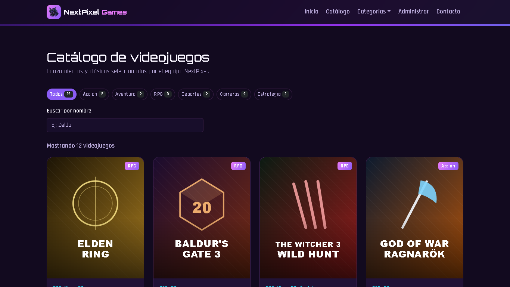 Catálogo generado dinámicamente | 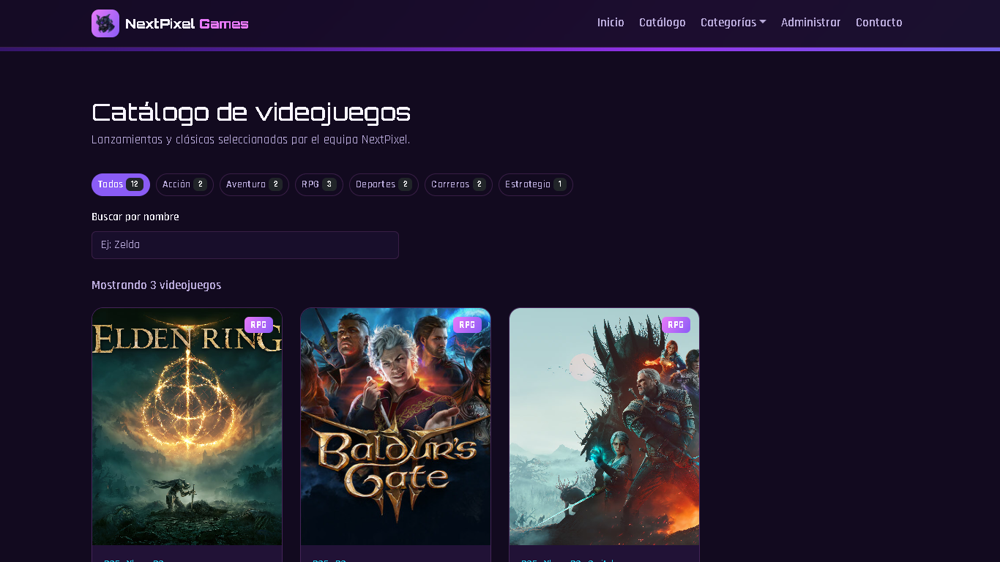 Filtro por categoría |
|  Dropdown de categorías en la Navbar | 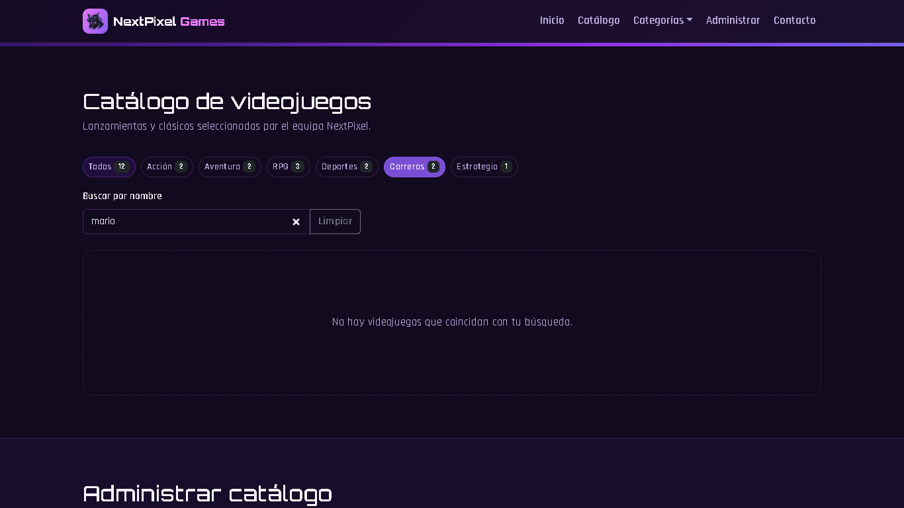 Búsqueda sin resultados |
| 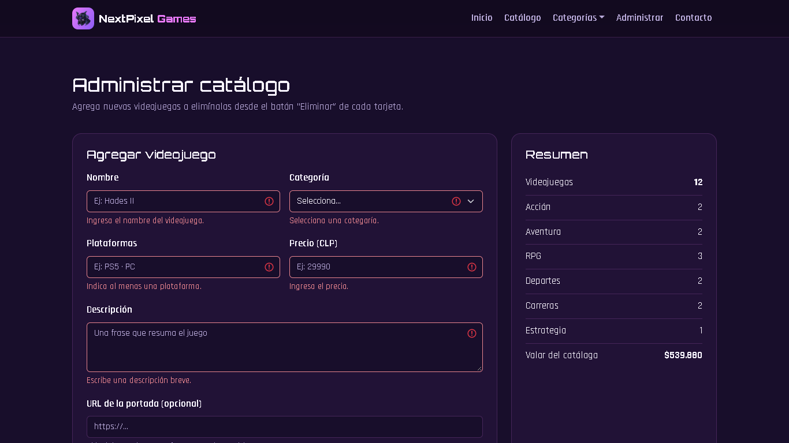 Validación al agregar un juego | 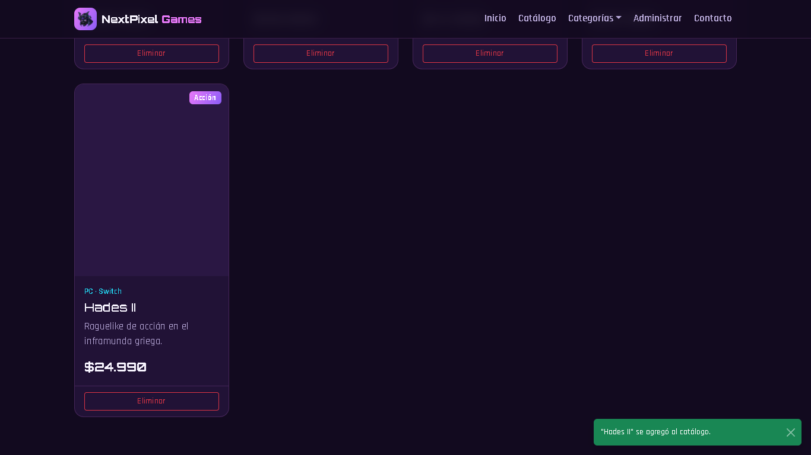 Juego agregado al catálogo |
| 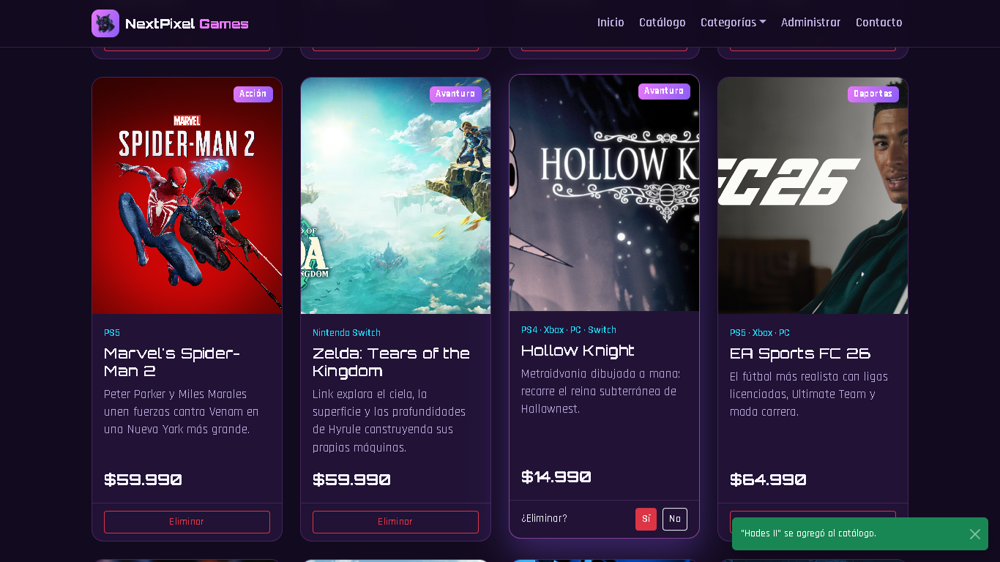 Confirmación para eliminar | 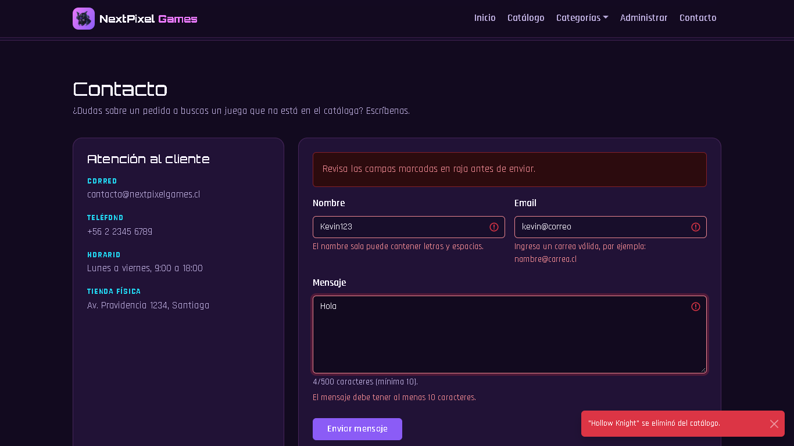 Contacto con errores |
| 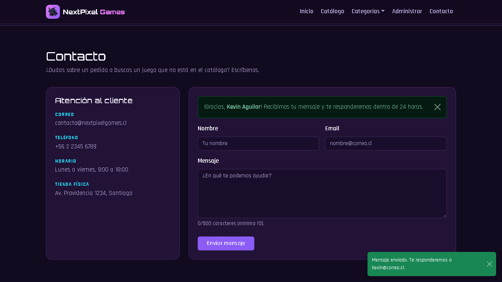 Mensaje enviado |  Catálogo en Microsoft Edge |

| Móvil y tablet | | |
|---|---|---|
| 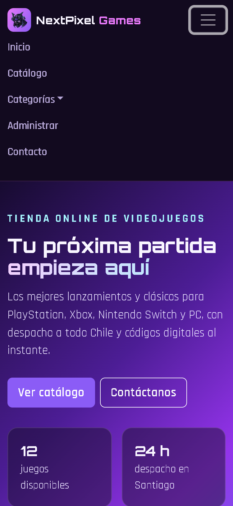 | 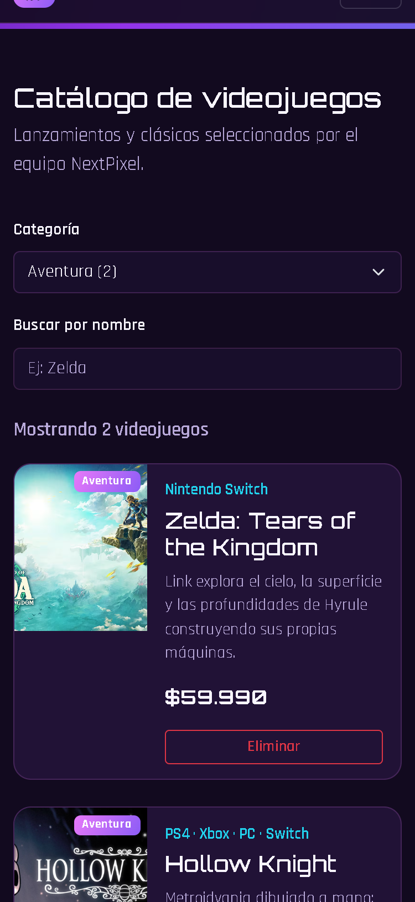 | 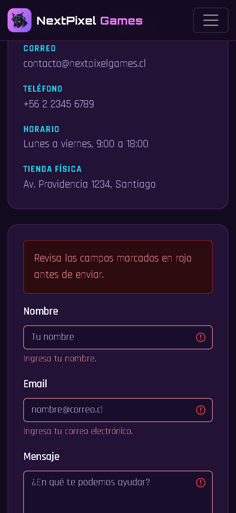 |
| Menú hamburguesa | Filtro con select | Validación en móvil |

## Despliegue en GitHub Pages

El proyecto usa el paquete `gh-pages`. `vite.config.js` define `base: '/nextpixel-games-eft/'`, que debe coincidir
con el nombre del repositorio.

```bash
npm run deploy
```

Esto compila el proyecto y publica la carpeta `dist/` en la rama `gh-pages`. En GitHub:
**Settings → Pages → Branch: `gh-pages` / root**.

---

Los nombres de los videojuegos pertenecen a sus respectivos dueños y se usan solo con fines académicos.
